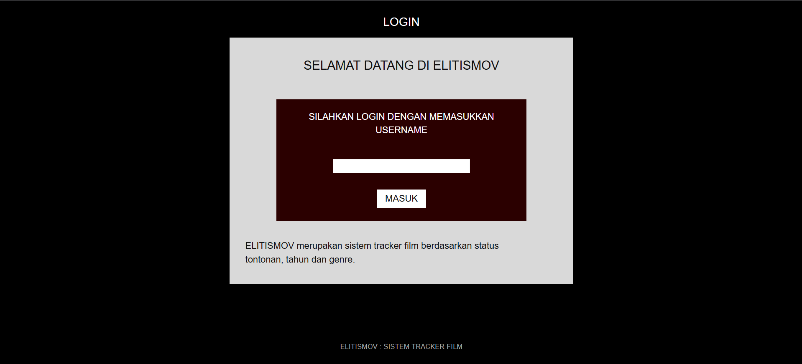
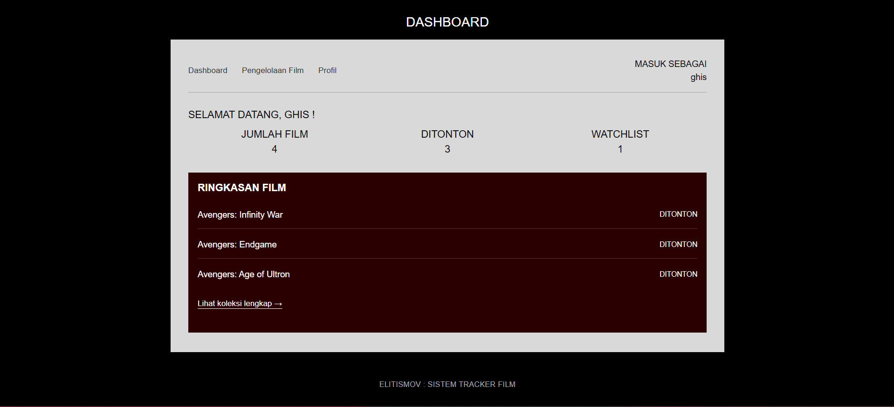
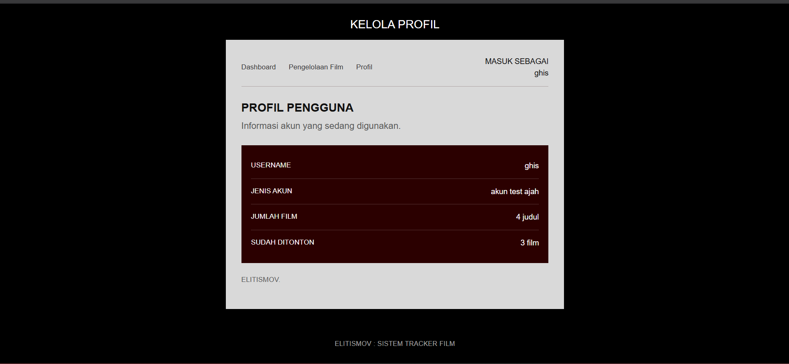
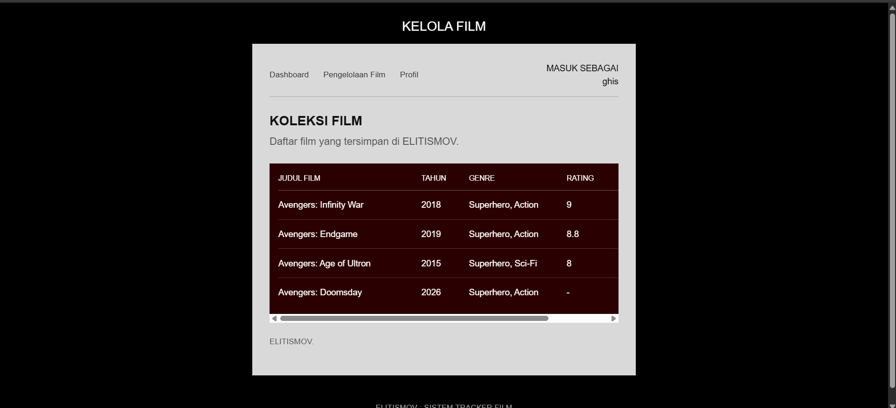

# ELITISMOV

ELITISMOV merupakan website sederhana untuk mengelola koleksi film pribadi. Website ini dibuat sebagai project mata kuliah Pemrograman Berbasis Web dengan menggunakan framework Laravel.

Melalui website ini, pengguna dapat melihat koleksi film berdasarkan judul, tahun rilis, genre, rating, dan status tontonan. Status film dibagi menjadi dua kategori, yaitu **Ditonton** dan **Watchlist**.

## Teknologi yang Digunakan

- **PHP** – Bahasa pemrograman backend.
- **Laravel** – Framework untuk pengembangan website.
- **Blade** – Template engine untuk mengatur tampilan halaman.
- **CSS** – Mengatur desain dan tampilan website.

## Fitur Website

1. **Login** – Memasukkan username untuk masuk ke website.
2. **Dashboard** – Menampilkan ringkasan jumlah koleksi film, film yang sudah ditonton, dan watchlist.
3. **Profil** – Menampilkan informasi pengguna dan ringkasan koleksi film.
4. **Pengelolaan Film** – Menampilkan daftar koleksi film beserta informasi tahun, genre, dan status tontonan.

## Tampilan Website

### 1. Halaman Login
Halaman awal untuk memasukkan username sebelum masuk ke website.



### 2. Halaman Dashboard
Menampilkan ringkasan koleksi film dan informasi statistik tontonan.



### 3. Halaman Profil
Menampilkan informasi pengguna dan ringkasan koleksi film.



### 4. Halaman Pengelolaan Film
Menampilkan seluruh daftar film yang tersimpan di dalam website.



## Cara Menjalankan Project

1. Clone repository ini:
   ```bash
   git clone URL_REPOSITORY
   ```

2. Masuk ke folder project:
   ```bash
   cd cinetrack-app
   ```

3. Install dependency Laravel:
   ```bash
   composer install
   ```

4. Jalankan server Laravel:
   ```bash
   php artisan serve
   ```

5. Buka alamat berikut di browser:
   ```text
   http://127.0.0.1:8000
   ```

## Catatan

Project ini masih menggunakan data film berbentuk array yang disimpan di Controller dan belum menggunakan database.
